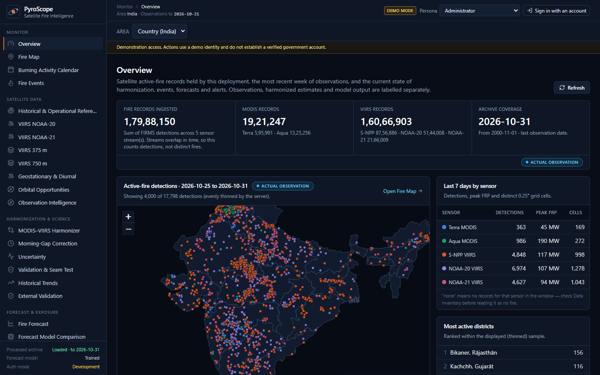
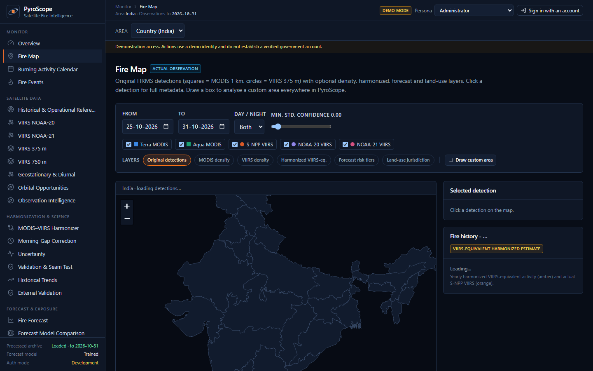
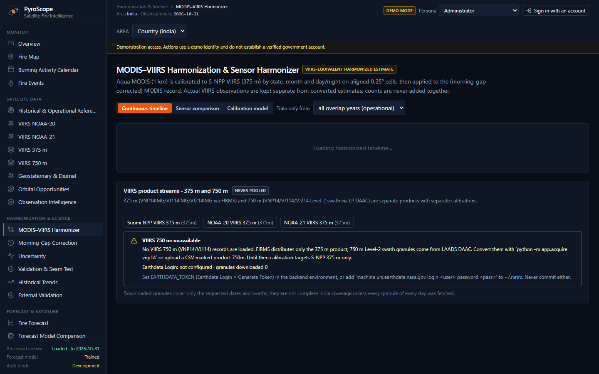
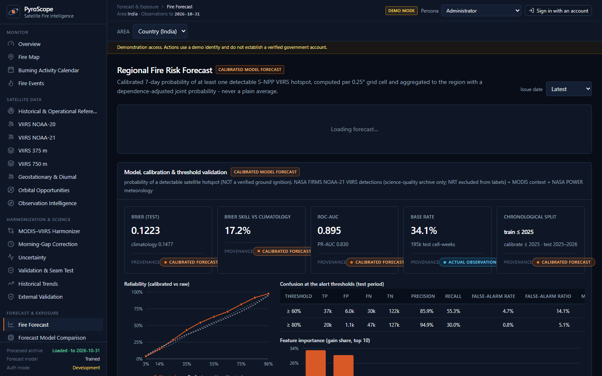
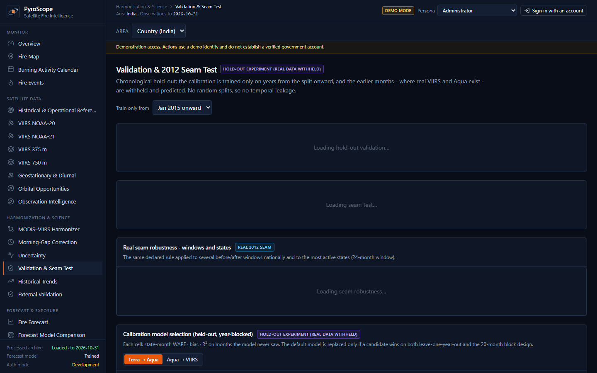
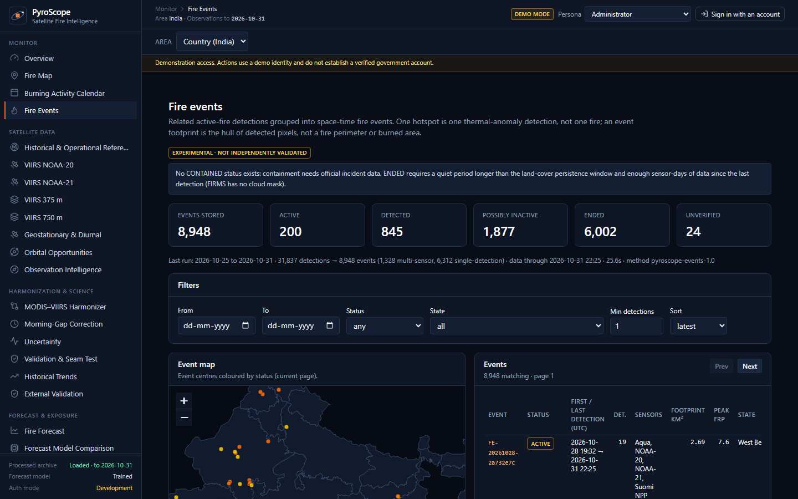
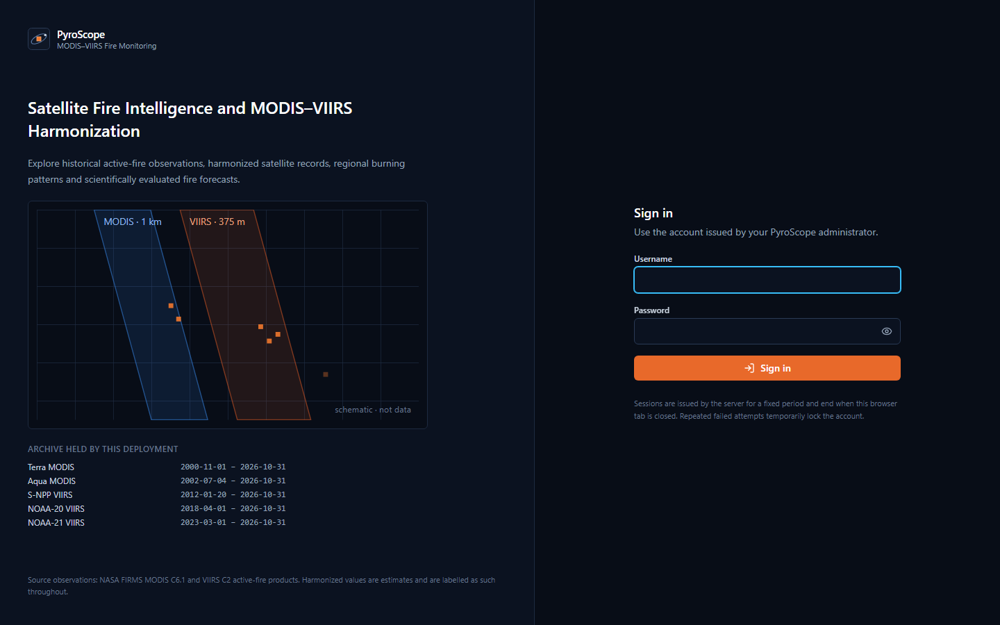
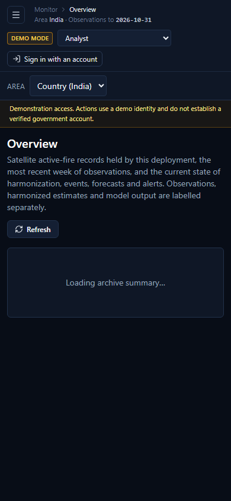
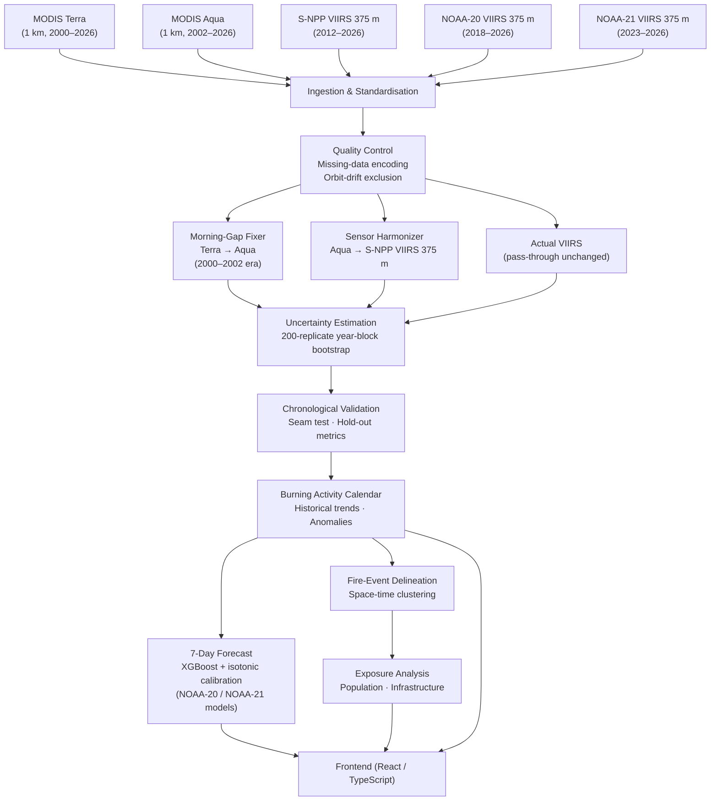
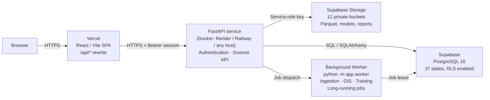

# PyroScope

**Satellite Fire Intelligence & MODIS–VIIRS Harmonization**

> *Turning fragmented satellite fire observations into a continuous, uncertainty-aware record of burning activity.*

PyroScope addresses the NASA Space Apps Challenge 2026 task **"Harmonization of MODIS and VIIRS Hot Spots"**. It ingests the full FIRMS active-fire record for India (2000–2026), builds a calibrated **VIIRS-equivalent** monthly detection series, validates it chronologically, and delivers historical fire intelligence, a seven-day hotspot-probability forecast, and a human-in-the-loop authority alert workflow.

---


> [!IMPORTANT]
> **CI note:** The latest observed `main` run reports 226 passed / 1 failed / 1 skipped for the backend suite. The failing test (`test_committed_database_carries_no_credentials`) is a guard that detected a password hash in the tracked `data/pyroscope.db`; the row was restored to the committed state and the test exists to prevent recurrence. PostgreSQL, frontend, and dependency-audit jobs passed. Docker and Playwright were skipped in that run.

---



---

## Table of Contents

1. [The Problem](#the-problem)
2. [PyroScope's Solution](#pyryscopes-solution)
3. [Main Features](#main-features)
4. [Screenshot Gallery](#screenshot-gallery)
5. [Scientific Methodology](#scientific-methodology)
6. [Validation Results](#validation-results)
7. [Data Sources](#data-sources)
8. [System Architecture](#system-architecture)
9. [Technology Stack](#technology-stack)
10. [Repository Structure](#repository-structure)
11. [Quick Start](#quick-start)
12. [Authentication](#authentication)
13. [Data Pipeline](#data-pipeline)
14. [Vercel / Supabase Deployment](#vercel--supabase-deployment)
15. [Environment Configuration](#environment-configuration)
16. [Testing](#testing)
17. [Known Limitations](#known-limitations)
18. [Acknowledgements](#acknowledgements)
19. [Documentation Index](#documentation-index)
20. [Roadmap](#roadmap)

---

## The Problem

> **NASA Space Apps Challenge 2026 — Official Challenge Statement**
>
> *Harmonization of MODIS and VIIRS Hot Spots*
>
> Understanding how burning activity is distributed across our planet over time, including wildfires and agricultural burns intense enough to be detected by satellite sensors, enables us to anticipate critical periods, guide monitoring efforts, and improve fire response. Satellites have tracked active fire hotspots for more than two decades, but the record is split across sensors whose data cannot be compared directly, leaving fire managers without a consistent picture of when and where burning has occurred. Your challenge is to build a web application that harmonizes these records into a burning activity calendar based on active fire hotspots, enabling early warning and emergency responders, scientists, and land managers to examine historical fire patterns, unusual conditions, and critical periods within a selected area of interest.

Three satellite generations detect active fires over India, but their raw counts cannot simply be added or compared:

| Sensor | Spatial resolution | Overpass (local solar) | FIRMS record starts |
|---|---|---|---|
| MODIS Terra | 1 km | ≈10:30 / 22:30 | 1 Nov 2000 |
| MODIS Aqua | 1 km | ≈13:30 / 01:30 | 4 Jul 2002 |
| Suomi NPP VIIRS | 375 m | ≈13:30 / 01:30 | 20 Jan 2012 |
| NOAA-20 VIIRS | 375 m | ≈13:30 / 01:30 | 1 Apr 2018 |
| NOAA-21 VIIRS | 375 m | ≈13:30 / 01:30 | 1 Mar 2023 |

The raw monthly detection count jumps by a factor of **~7** at the 2012 MODIS→VIIRS transition, solely because VIIRS has finer spatial resolution and higher sensitivity — not because fires increased. Terra's morning overpass (10:30) also sees a systematically different subset of fires than the afternoon passes shared by all later sensors. Any analysis built on the raw joined record inherits these artificial discontinuities.

---

## PyroScope's Solution

PyroScope resolves the multi-sensor gap through a staged, evidence-based calibration pipeline:

1. **Standardisation** — every FIRMS detection is kept as an individual record, one row per observation; sensors are never pooled.
2. **Missing-data encoding** — gaps are encoded as `null` and shown as hatched in the calendar; they are never treated as zero.
3. **Terra/Aqua Morning-Gap Correction** — a state×month×day/night model learns the Terra→Aqua conversion from fully covered overlap months; MODIS orbit-drift years (2023+) are excluded from calibration.
4. **Aqua→VIIRS Sensor Harmonizer** — the same model form extends Aqua (actual or morning-gap estimate) to the S-NPP 375 m VIIRS scale; 375 m and 750 m products are never pooled.
5. **Actual VIIRS pass-through** — real VIIRS observations are never modified.
6. **Uncertainty estimation** — 200-replicate whole-year block bootstrap refits both calibration stages; each replicate also draws an out-of-sample log-residual to capture month-to-month scatter.
7. **Chronological hold-out validation** — training always precedes the test period; the test set is real VIIRS months never seen during training.
8. **2012 seam test** — the residual artificial discontinuity is measured with a fixed-threshold rule and reported transparently (current verdict: **PARTIAL**).
9. **Operational sensor transition** — with S-NPP science data delivery ended (2 Nov 2026), NOAA-21 is the declared operational reference for live forecasting; S-NPP stays the historical harmonization reference.

> [!NOTE]
> Harmonized estimates are estimates. They are always distinguished from actual satellite observations. The 2012 seam PARTIAL verdict is preserved and reported as a limitation, not hidden.

---

## Main Features

### Satellite Data and Harmonization

- **Five FIRMS archive streams** fully loaded: MODIS C6.1 (Terra + Aqua), VIIRS C2 375 m (S-NPP, NOAA-20, NOAA-21).
- **State×month×day/night calibration model** with national-value shrinkage; aggregates consistently to any spatial subset.
- **Morning-gap correction** for the Terra-only era (1 Nov 2000 – 3 Jul 2002); MODIS orbit-drift years excluded.
- **VIIRS 750 m pathway** (VNP14/VJ114/VJ214 v002) — code and converter implemented; **blocked by Earthdata LAADS licence acceptance** (download redirects verified in CMR; no 750 m records are loaded).
- **Sensor selection UI** (`/reference`) shows criteria C1–C6 and the current operational reference (NOAA-21 APPROVED).
- **Bootstrap uncertainty bands** (5–95 %, nominal 90 %); empirical coverage reported against held-out months.

### Historical Fire Intelligence

- **Burning Activity Calendar** — daily, monthly, and annual views per sensor or on the VIIRS-equivalent scale; missing days shown hatched.
- **Historical trends** and **seasonal baselines** with anomaly detection (high activity distinguished from incomplete coverage).
- **State and district analysis** with FRP and detection counts.
- **Fire-event delineation** — detections linked into space-time events with stable IDs, merge/split history, and evidence-based status (demo DB: India 25–31 Oct 2026, 8,948 events from 31,837 detections). *(Implemented but not independently validated against official incident records.)*
- **Cross-sensor event association** — footprint-based linking; raw observations retained via `obs_key`.

### Forecasting

- **Seven-day hotspot-detection probability** per 0.25° cell — the target is *at least one presumed-vegetation VIIRS detection in the cell within 7 days*, **not** a verified ground ignition.
- **Independent per-sensor models** for NOAA-20 and NOAA-21 (each trained, calibrated, and tested on its own chronological period).
- **Five candidate models** compared on equal footing (climatology, logistic regression, random forest, HistGradientBoosting, XGBoost); XGBoost retained by a declared replacement rule.
- **Isotonic calibration** applied after the main split; Brier, ROC-AUC, PR-AUC, ECE, and rolling-origin Brier reported.
- **Model cards** at `GET /api/forecast/model-card` and in [`docs/MODEL_COMPARISON.md`](docs/MODEL_COMPARISON.md).
- **Regional aggregation:** `P(any detection in region) = 1 − Π(1 − pᵢ)^α`, α fitted on calibration years.

### Environmental Intelligence

| Capability | Status |
|---|---|
| Population exposure (WorldPop 2020, 1,380,004,385 people, 4,885 cells) | Done and tested |
| Infrastructure exposure — OSM point facilities (hospitals, schools, power substations, …) | Done and tested |
| Infrastructure exposure — roads, railways, transmission lines, settlements | Not loaded; reported as missing, never zero |
| Critical-region scoring (population, detections, forecast, facilities) | Implemented; weights not independently validated |
| Fire-event delineation and API | Done and tested |
| Emissions estimates — FRP/FRE mass balance with Monte Carlo (Wooster 2005, GFED4 EFs) | Implemented; not externally validated |
| Burned-area pipeline (MCD64A1/VNP64A1) | Blocked by Earthdata LAADS licence |
| Smoke trajectories (GFS forward trajectories) | Experimental; people-near-path computed; no dispersion model |
| PM₂.₅ concentration modelling | Not implemented (no dispersion model installed) |
| Geostationary fusion (INSAT / Meteosat-IODC) | Blocked by data licence / registration |
| Orbital overpass prediction (SGP4, CelesTrak TLEs) | Done and tested |

> A nearby population or facility count describes proximity to detected heat. It is not a prediction that people or assets will burn, and it is not a verified incident report.

---

## Screenshot Gallery

| Dashboard Overview | Fire Map |
|:---:|:---:|
|  |  |
| *Harmonized Burning Activity Calendar with VIIRS-equivalent monthly counts and anomaly bands* | *Active-fire map with per-sensor detection layers and 0.25° grid overlay* |

| Harmonizer (Calibration) | 7-Day Forecast |
|:---:|:---:|
|  |  |
| *Calibration ratios, uncertainty bands, and held-out validation metrics* | *Hotspot-detection probability map (NOAA-21 operational model)* |

| Validation Report | Fire Events |
|:---:|:---:|
|  |  |
| *Chronological hold-out WAPE, bias, R², and baseline comparisons* | *Space-time fire events with merge/split history and cross-sensor association* |

| Production Login | Mobile View |
|:---:|:---:|
|  |  |
| *Server-side authentication with rate limiting and session management* | *Responsive layout on a narrow viewport* |

---

## Scientific Methodology

The calibration model is applied identically for both harmonization steps (Terra→Aqua and Aqua→VIIRS):

$$\hat{y} = F[s, m, d] \cdot x + a[s, m, d] \cdot N_{\text{silent}}$$

where:
- $x$ = predictor-sensor detections (presumed-vegetation FIRMS type 0, plus untyped NRT)
- $N_{\text{silent}}$ = 0.25° cells where the predictor saw nothing (the target may still see small fires)
- $F$ = ratio of target to predictor detections in co-active cells
- $a$ = mean target detections per predictor-silent cell
- $s$ = state, $m$ = month-of-year, $d$ = day/night

State parameters are shrunk toward the national value. Calendar months with fewer than 200 national predictor detections fall back to the pooled ratio and are flagged **unreliable**.

**Provenance tags per month:** `actual_viirs` · `sensor_calibrated` · `morning_gap_sensor` · `no_data`

**Key design rules:**
- MODIS and VIIRS counts are never added.
- 375 m and 750 m VIIRS products are never pooled.
- FRP is kept separate from detection counts.
- Missing observations are encoded as `null`, never as zero.
- Validation is always chronological; test months are never seen during training.
- The 2012 seam is not forced smooth; the residual is measured and reported.
- Hotspot-detection probability is not ignition probability.

Full methodology: [`docs/METHODOLOGY.md`](docs/METHODOLOGY.md)

---

## Validation Results

All metrics are computed from the loaded data at report-generation time by `python -m app.science_report`. Nothing is hand-typed.

### Sensor Coverage Loaded

| Satellite | Science-quality archive | NRT |
|---|---|---|
| Terra | 2000-11-01 → 2026-08-31 | 2026-09-01 → 2026-10-31 |
| Aqua | 2002-07-04 → 2026-08-30 | 2026-09-01 → 2026-10-31 |
| Suomi NPP | 2012-01-20 → 2026-07-31 | 2026-08-01 → 2026-10-31 |
| NOAA-20 | 2018-04-01 → 2026-07-31 | 2026-08-01 → 2026-10-31 |
| NOAA-21 | 2023-03-01 → 2026-07-31 | 2026-08-01 → 2026-10-31 |

MODIS orbit drift (mean daytime overpass shifted > 0.25 h from baseline) detected for Terra and Aqua from 2023 onward; those years are excluded from calibration.

### Chronological Held-Out Validation (59 real S-NPP months, 2012-02 → 2016-12)

Training on 2017–2022 only; test months never seen during training.

| Method | n months | WAPE | Bias | R² |
|---|---|---|---|---|
| **PyroScope calibrated harmonization** | 59 | **13.0 %** | **−0.3 %** | **0.960** |
| Constant VIIRS/Aqua ratio baseline | 59 | 32.0 % | 1.4 % | 0.800 |
| Raw MODIS (Terra + Aqua, uncorrected) | 59 | 85.1 % | −85.1 % | −0.371 |

**Uncertainty band coverage:** 93.2 % empirical on held-out months (nominal 90 % — well calibrated).

> WAPE = Weighted Absolute Percentage Error. The PyroScope rule classifies WAPE ≤ 20 % and |bias| ≤ 10 % as *good*; this is a project convention, not an external standard.

### Morning-Gap Correction (Simulated, 20-Month Aqua-Withheld Blocks)

7 blocks, 140 months. Calibration refitted on every other overlap year; hidden Aqua is the answer key. Labelled *simulated*: it tests the method, not the 2000–2002 correction, which has no ground truth.

| Method | WAPE | Bias | R² | Band coverage |
|---|---|---|---|---|
| **Calibrated Terra→Aqua** | **18.4 %** | **+3.7 %** | **0.920** | 91.4 % |
| Constant Aqua/Terra ratio | 45.3 % | 5.0 % | 0.641 | — |

> **Known limitation.** When trained only on later years and predicting backward across a full decade (the stress test), the state-level model drifts to +29.7 % bias. The national seasonal ratio stays at +1.0 % bias in the same test. National totals far outside the overlap period should be read with this in mind.

### 2012 MODIS–VIIRS Seam Test (±24 Months, India)

- **Raw step:** ×6.98 (factor-of-7 artificial jump)
- **Harmonized step:** ×1.027 (band 0.938–1.093)
- **Unchanged Aqua reference step:** ×1.103 (genuine +10 % fire activity)
- **Artificial jump reduction:** 1.845 → 0.072 ln-units (−96.1 %)
- **Verdict: PARTIAL** — the reference-sensor step (1.103) lies outside the harmonized band (0.938–1.093). The harmonization damps part of the genuine +10 % change. Thresholds are fixed in advance and not tuned to obtain a pass.
- **±36-month window:** pass. Five of eight tested states: pass; three: partial.

### Seven-Day Hotspot-Detection Forecast (NOAA-21, Test Period 2025-10-01 → 2026-07-25)

194,661 test rows; base rate 0.341. **This forecast predicts whether a satellite hotspot will be detected, not whether a wildfire will ignite.**

| Metric | Calibrated XGBoost | Climatology baseline |
|---|---|---|
| Brier | 0.1223 | 0.1477 |
| Brier skill score | 0.172 | 0.000 |
| ROC-AUC | 0.895 | 0.851 |
| PR-AUC | 0.830 | 0.735 |

| Threshold | Precision | Recall | False-alarm rate |
|---|---|---|---|
| 60 % (HIGH) | 0.859 | 0.553 | 4.7 % |
| 80 % (VERY HIGH) | 0.949 | 0.300 | 0.8 % |

### SGP4 Orbital Overpass Prediction (400 Actual Detections per Satellite)

| Satellite | Mean |residual| (min) | 95th percentile (min) | Within 10 min |
|---|---|---|---|
| Terra | 0.83 | 1.83 | 100 % |
| Aqua | 0.82 | 1.83 | 100 % |
| Suomi NPP | 0.90 | 2.00 | 100 % |
| NOAA-20 | 0.85 | 2.17 | 100 % |
| NOAA-21 | 0.86 | 1.84 | 100 % |

---

## Data Sources

| Dataset | Sensor / Product | Coverage | Load status |
|---|---|---|---|
| NASA FIRMS MODIS C6.1 | Terra + Aqua, MCD14ML, 1 km | India bbox (68–98 E, 6–36 N), 2000-11 → 2026-10 | **Loaded** |
| NASA FIRMS VIIRS C2 375 m | S-NPP, NOAA-20, NOAA-21 | India bbox, 2012-01 → 2026-10 | **Loaded** |
| NASA FIRMS VIIRS 750 m | VNP14/VJ114/VJ214 v002, LP DAAC | India bbox | Blocked (Earthdata LAADS licence) |
| NASA POWER | Daily weather (surface meteorology) | India, auxiliary | Loaded (auxiliary) |
| NASA MCD12Q1 | Land-cover context, GIBS | India | Loaded (auxiliary) |
| MODIS MCD64A1 | Burned area (HDF4-EOS) | — | Blocked (Earthdata) |
| VIIRS VNP64A1 | Burned area | — | Blocked (Earthdata) |
| WorldPop 2020 | 1 km UN-adjusted population counts | India, 1,380,004,385 people | **Loaded** (CC BY 4.0) |
| OpenStreetMap | Facilities in 11 categories | India, 161,952 facilities | **Loaded** (ODbL) |
| OpenStreetMap | Roads, railways, power lines, settlements | India | Not loaded; reported missing |
| geoBoundaries | Administrative boundaries (states, districts) | India | **Loaded** |
| CelesTrak | TLEs for 5 satellites | Epoch 2026-11-14 | **Loaded** |
| MOSDAC / INSAT | Geostationary fire observations (3DIMG FIR) | — | Blocked (registration required) |
| OpenAQ / data.gov.in | Ground PM₂.₅ / incident registers | — | Blocked (credentials) |

All five FIRMS archives pass ZIP CRC verification; SHA-256 is recorded in `data/processed/archive_checksums.json`.

---

## System Architecture

### Scientific Data Flow



### Deployment Architecture



> [!NOTE]
> Vercel and Supabase are **configured and locally tested**; no live project is connected and no production deployment URL exists. The `vercel.json` rewrites `/api/*` to `https://pyra-cf95.onrender.com/api/$1` as a reference configuration. No claim is made that this URL is active.

---

## Technology Stack

### Backend (Python 3.11)

| Package | Purpose |
|---|---|
| FastAPI ≥ 0.110, Uvicorn | REST API and ASGI server |
| SQLAlchemy ≥ 2.0, psycopg3 | ORM, PostgreSQL / SQLite |
| Pandas ≥ 2.2, NumPy ≥ 1.26, PyArrow ≥ 15 | Data processing, Parquet |
| Scikit-learn ≥ 1.4, XGBoost ≥ 2.0 | Forecast models, isotonic calibration |
| Shapely ≥ 2.0, SciPy ≥ 1.11 | GIS, KD-trees, connected components |
| Rasterio ≥ 1.3 | WorldPop GeoTIFF block reads |
| H5py ≥ 3.10 | VIIRS 750 m HDF5 granules |
| PyHDF ≥ 0.11.4 | MCD64A1 burned-area HDF4-EOS |
| Osmium ≥ 4.0 | OpenStreetMap PBF parsing |
| SGP4 ≥ 2.23 | Orbital overpass prediction |
| Pillow ≥ 13.0, ReportLab ≥ 4.0 | PDF report generation |

### Frontend (TypeScript / React 18)

| Package | Purpose |
|---|---|
| React 18, React DOM | UI framework |
| TypeScript ~5.6, Vite ≥ 8 | Build toolchain |
| Tailwind CSS 3.4 | Utility-first styling |
| Leaflet 1.9, React Leaflet 4.2 | Interactive fire maps |
| Recharts 3.10 | Charts and time-series plots |
| Lucide React | Icon library |
| React Router DOM 7 | Client-side routing |

### Infrastructure

| Tool | Role |
|---|---|
| Docker, Docker Compose | Local deployment (api, worker, frontend/nginx on port 8080) |
| Nginx | Reverse proxy in the Docker frontend container |
| GitHub Actions | CI: backend tests, audit, frontend, PostgreSQL, Vercel build, Docker, Playwright, data-integration |
| Vercel | React/Vite frontend hosting (SPA rewrites) |
| Supabase | PostgreSQL 16, Row Level Security, private object storage |
| Render / Railway | Reference backend hosting targets (render.yaml included) |

---

## Repository Structure

```
Pyra/
├── backend/
│   ├── app/                    # All Python application code
│   │   ├── harmonize.py        # Calibration, bootstrap, validation, seam test
│   │   ├── forecast.py         # XGBoost + isotonic calibration, model cards
│   │   ├── ingest.py           # FIRMS archive parsing and standardisation
│   │   ├── store.py            # Coverage / missing-data tracking, Parquet store
│   │   ├── pipeline.py         # CLI orchestrator (restartable, checkpointed)
│   │   ├── worker.py           # Persistent background job worker
│   │   ├── main.py             # FastAPI application and routes
│   │   ├── security.py         # Auth: PBKDF2, session tokens, roles, rate limits
│   │   ├── events.py           # Fire-event delineation and API
│   │   ├── exposure.py         # Population + infrastructure exposure
│   │   ├── emissions.py        # FRP/FRE mass balance with Monte Carlo
│   │   ├── smoke.py            # Experimental GFS forward trajectories
│   │   ├── orbits.py           # SGP4 overpass prediction
│   │   ├── operational.py      # Sensor transition logic (C1–C6 criteria)
│   │   └── ...                 # ~45 modules total
│   ├── tests/                  # pytest suite (226+ tests)
│   └── requirements.txt
├── frontend/
│   ├── src/                    # React / TypeScript pages and components
│   └── package.json
├── docs/
│   ├── METHODOLOGY.md          # Scientific method (complete)
│   ├── SCIENTIFIC_VALIDATION.md # Generated metrics (python -m app.science_report)
│   ├── screenshots/auth-ui/    # Application screenshots
│   └── ...                     # 20+ methodology and deployment docs
├── data/
│   ├── processed/              # Parquet summaries, trained models, manifests
│   └── auxiliary/              # Population, infrastructure, TLE, exposure layers
├── supabase/migrations/        # PostgreSQL schema (37 tables, RLS)
├── .github/workflows/          # ci.yml (main CI), data-integration.yml (manual)
├── DL_FIRE_*.zip               # Git LFS: five FIRMS archives (430+ MB total)
├── docker-compose.yml          # Services: backend API, worker, frontend/nginx
├── vercel.json                 # Vercel frontend + API proxy config
├── render.yaml                 # Render.com backend reference config
└── Dockerfile                  # Python 3.11-slim backend image
```

---

## Quick Start

### Prerequisites

- Python **3.11** (`.python-version` pins this)
- Node.js **20**, npm
- Git with **Git LFS** (or use the Python LFS recovery fallback)

### 1. Clone

```bash
git clone https://github.com/HIFIGUY1234/Pyra.git
cd Pyra
```

### 2. Recover the FIRMS Data Archives

The five `DL_FIRE_*.zip` files are Git LFS objects. A plain clone gives 133-byte pointer files; PyroScope detects them and says so.

```bash
# Option A — with git-lfs installed (recommended):
git lfs install
git lfs pull

# Option B — without git-lfs (Python fallback, downloads from GitHub LFS media,
#              verifies SHA-256 against the pointer, resumes interrupted transfers):
cd backend
python -m app.acquire lfs
```

### 3. Backend

**Windows (PowerShell):**
```powershell
cd backend
python -m venv .venv
.\.venv\Scripts\Activate.ps1
pip install -r requirements.txt
```

**macOS / Linux:**
```bash
cd backend
python -m venv .venv
source .venv/bin/activate
pip install -r requirements.txt
```

**Configure (optional):**
```bash
cp ../.env.example ../.env   # defaults work for local evaluation without secrets
```

**Apply schema migrations:**
```bash
python -m app.migrate
```

**Start the API:**
```bash
uvicorn app.main:app --port 8000
```

> Processed Parquet summaries and a trained model are committed in `data/processed/`, so the API serves data immediately after `pip install` even before re-running the pipeline.

### 4. Frontend

```bash
cd frontend
npm ci
npm run dev      # → http://localhost:5173 (proxies /api to :8000)
```

### 5. Docker (all services, port 8080)

```bash
cp .env.example .env     # then edit as needed
docker compose up --build
# UI + API + background worker on http://localhost:8080
```

The Compose file runs three services: `backend` (FastAPI, port 8000, internal), `worker` (background job processor, same image), and `frontend` (nginx, port 8080, public). Volumes mount `./data` and `./docs` into both Python containers; the FIRMS archives are mounted read-only. The worker waits for the backend health check before starting (schema migrations are run by the API process first).

---

## Authentication

### Development Mode (default: `PYROSCOPE_AUTH_MODE=dev`)

Demo personas via the `X-User` header — no password required. The UI displays a **DEV PERSONA** banner.

| Persona | Role | Access |
|---|---|---|
| `analyst` | Analyst | View all fire intelligence |
| `officer` | Forest Officer | Submit and review alerts |
| `manager` | Organisation Manager | Manage users within org |
| `admin` | Administrator | Full system access |

Switch personas freely in the UI. **Do not use development mode on a public host** — the `X-User` header is never validated.

### Production Mode (`PYROSCOPE_AUTH_MODE=production`)

- Real username + password (PBKDF2-SHA256 hashing)
- Session tokens stored only as SHA-256 hashes; expiring; revoked on logout
- 5 failed logins lock an account for 15 minutes
- Role-based permission checks on every `/api` route
- Organisation isolation (users see only their own organisation's data)
- No `X-User` development header accepted
- Bootstrap the admin account: `PYROSCOPE_ADMIN_PASSWORD=<secret>` on first start

---

## Data Pipeline

The pipeline CLI runs the full ingestion-to-forecast chain, restartably, with per-source checkpoints:

```bash
cd backend
# Full pipeline (first run: ~10–20 minutes with archives present):
python -m app.pipeline --recover-lfs

# Incremental (only new sources):
python -m app.pipeline --only-new

# Validation only (read-only: archive integrity, hold-out metrics, seam test):
python -m app.pipeline --validate-only

# VIIRS 750 m granules (requires Earthdata token in environment):
python -m app.pipeline --viirs750 2025-01-01 2025-01-31

# Generate the scientific report (writes docs/SCIENTIFIC_VALIDATION.md):
python -m app.science_report
```

**All supported flags:** `--only-new` · `--skip-ingest` · `--skip-weather` · `--skip-train` / `--retrain` · `--rebuild-geo` · `--recover-lfs` · `--skip-report` · `--refresh-exposure` · `--refresh-tle` · `--compare-forecast` · `--viirs750 START END` · `--dry-run` · `--validate-only`

Unknown flags are rejected. Step outcomes are recorded in `data/processed/pipeline_state.json`.

**Background worker** (long-running jobs, used in Docker or production):
```bash
python -m app.worker
```

---

## Vercel / Supabase Deployment

The intended production topology separates concerns clearly:

| Component | Platform | Status |
|---|---|---|
| React / Vite frontend (SPA) | Vercel | Config complete; not deployed to a live project |
| FastAPI backend + authentication | Docker host (Render / Railway / any) | Config complete; not publicly hosted |
| Background worker | Same image, separate process | Config complete; not publicly hosted |
| PostgreSQL database | Supabase | Migrations tested locally and in CI (PostgreSQL 16); no Supabase project connected |
| Object storage | Supabase Storage | REST + TUS client tested against a fake endpoint; not connected |

**Why not serverless Python on Vercel?** The scientific stack (pandas, rasterio/GDAL, h5py, pyhdf, osmium, xgboost, scipy) exceeds Vercel's 250 MB Python function bundle limit, and jobs run for minutes to hours. The Python API stays on a persistent host.

**Row Level Security:** all 37 database tables have RLS enabled; `anon` and `authenticated` roles have no table privileges; the browser cannot read tables even with the public anon key.

### Manual Setup Checklist

See [`docs/FINAL_MANUAL_SETUP.md`](docs/FINAL_MANUAL_SETUP.md) for the exact steps:

- Earthdata LAADS licence acceptance + LP DAAC authorisation (unlocks VIIRS 750 m and burned area)
- MOSDAC / LSA SAF registration (unlocks INSAT geostationary)
- Create a Supabase project, run `supabase/migrations/`, configure `DATABASE_URL`
- Deploy backend image to a persistent host; set `VITE_API_BASE_URL` in Vercel
- Configure SMTP or webhook for real authority notifications

---

## Environment Configuration

Copy `.env.example` to `.env`. Never commit real secrets.

```bash
cp .env.example .env
```

Key variables (see `.env.example` for the full annotated list):

| Variable | Default | Purpose |
|---|---|---|
| `PYROSCOPE_AUTH_MODE` | `dev` | `dev` (persona headers) or `production` (real auth) |
| `DATABASE_URL` | SQLite `data/pyroscope.db` | PostgreSQL or Supabase connection string |
| `PYROSCOPE_STORAGE` | `local` | `local` or `supabase` object storage |
| `SUPABASE_URL` | — | Supabase project URL (backend only) |
| `SUPABASE_SERVICE_ROLE_KEY` | — | Server-side service key (never in frontend) |
| `PYROSCOPE_ADMIN_PASSWORD` | — | Bootstraps the admin account once (production) |
| `FIRMS_MAP_KEY` | — | Free NASA FIRMS API key for scripted downloads |
| `EARTHDATA_TOKEN` | — | Earthdata token for VIIRS 750 m / burned area |
| `PYROSCOPE_NOTIFY_PROVIDER` | `simulated` | `simulated`, `webhook`, or `smtp` |
| `PYROSCOPE_SESSION_HOURS` | `12` | Bearer session lifetime |

Notifications default to **simulated** (in-app queue only, clearly labelled). No real SMTP or webhook delivery has been exercised from this repository (no credentials are present). PyroScope never issues public emergency warnings or dispatches emergency services.

---

## Testing

### Backend (pytest)

```bash
cd backend
python -m pytest tests -q
```

The suite runs against a temporary copy of the database; the working `data/pyroscope.db` is not modified. Archives remain as LFS pointer stubs in CI; the LFS-detection code path is exercised.

**Current status:** 226 passed, 1 failed (`test_committed_database_carries_no_credentials` — password hash guard; the tracked DB was restored), 1 skipped (PostgreSQL test; passes when `PYROSCOPE_TEST_PG_URL` is set).

The PostgreSQL / Supabase CI job (separate, runs `pytest tests/test_ultimate.py -k "postgres or supabase"` against a real PostgreSQL 16 service) passes.

### Frontend

```bash
cd frontend
npm run typecheck    # TypeScript strict-mode type check
npm run lint         # ESLint (0 errors)
npm test             # Vitest (31 passed)
npm run build        # Production bundle
npm audit --audit-level=moderate   # Dependency vulnerability scan
```

### Playwright End-to-End

```bash
cd frontend
npx playwright install chromium
npm run e2e          # 7 journeys: A (calendar/map/trends), B-D (alerts/auth), E (Earthdata), F (events), mobile
```

Playwright runs in CI against the real API (`ci.yml` and `data-integration.yml`).

### Security Audits

```bash
cd backend && pip-audit -r requirements.txt    # No known vulnerabilities (pip-audit)
cd frontend && npm audit                       # 0 high/critical vulnerabilities
```

---

## Known Limitations

| Area | Status | Detail |
|---|---|---|
| 2012 MODIS–VIIRS seam | **PARTIAL** (not hidden) | Reference-sensor step (×1.103) lies outside the harmonized band (×0.938–1.093). The 96.1 % reduction in artificial jump is genuine, but part of the real +10 % change is damped. |
| VIIRS 750 m authentic data | Blocked | Earthdata LAADS licence not accepted; LP DAAC app not authorised. Products verified in CMR. |
| Burned-area pipeline | Blocked | MCD64A1/VNP64A1 blocked by the same Earthdata/LAADS licence. |
| INSAT / geostationary validation | Blocked | MOSDAC registration required; KML import code exists but is untested on an authentic file. |
| Ground PM₂.₅ / emissions validation | Blocked | No OpenAQ or data.gov.in key; no HYSPLIT dispersion model. |
| Official incident cross-validation | Blocked | Import and matching implemented and unit-tested on synthetic data; no access to actual incident registers. |
| Road / railway / power-line exposure | Not loaded | Reported as missing; never shown as zero. |
| Morning-gap backward extrapolation | Limitation | National bias +12.2 % on the backward rolling-origin stress test. National totals before Aqua (pre-July 2002) carry this uncertainty. |
| Fire-event status | Limitation | No `CONTAINED` status (requires ground confirmation). `ENDED` requires sufficient observing opportunities without detections. |
| Linear infrastructure | Partial | Geofabrik India PBF downloaded (1.72 GB); linear layer build was in progress at report time. |
| Backend CI test | Known failure | `test_committed_database_carries_no_credentials` — guard test for password hashes in the tracked DB; row was restored. |
| External production deployment | Not done | No live Vercel, Supabase, or backend hosting configured. |

---

## Acknowledgements

**Satellite data:**
- [NASA FIRMS](https://firms.modaps.eosdis.nasa.gov/) — MODIS C6.1 and VIIRS C2 active-fire archives (Terra, Aqua, S-NPP, NOAA-20, NOAA-21)
- [NASA LAADS DAAC](https://ladsweb.modaps.eosdis.nasa.gov/) — VIIRS 750 m granules (VNP14/VJ114/VJ214); [LP DAAC](https://lpdaac.usgs.gov/) — burned-area products (MCD64A1, VNP64A1)
- [NASA POWER](https://power.larc.nasa.gov/) — daily surface meteorology
- [NASA Earthdata](https://earthdata.nasa.gov/) — unified data access

**Auxiliary layers:**
- [WorldPop](https://www.worldpop.org/) — Global 2000–2020 1 km population counts, India 2020 (CC BY 4.0; doi:10.5258/SOTON/WP00671)
- © [OpenStreetMap contributors](https://www.openstreetmap.org/copyright) (ODbL) — facility and infrastructure data
- [geoBoundaries](https://www.geoboundaries.org/) — administrative boundary polygons
- [CelesTrak](https://celestrak.org/) — two-line element sets for orbital prediction

**Geostationary (blocked):**
- [MOSDAC](https://mosdac.gov.in/) — INSAT-3DR/3DS fire products (registration required)

---

## Documentation Index

### Scientific Methodology
| Document | Contents |
|---|---|
| [docs/METHODOLOGY.md](docs/METHODOLOGY.md) | Calibration model, uncertainty, validation design, seam test, model selection rules |
| [docs/SCIENTIFIC_VALIDATION.md](docs/SCIENTIFIC_VALIDATION.md) | All metrics, generated from loaded data (`python -m app.science_report`) |
| [docs/FINAL_PROJECT_REPORT.md](docs/FINAL_PROJECT_REPORT.md) | Problem, method, data, results, limitations, reproducibility |
| [docs/MODEL_COMPARISON.md](docs/MODEL_COMPARISON.md) | Five forecast candidates on equal footing, rolling origins, model cards |

### Satellite Data
| Document | Contents |
|---|---|
| [docs/DATA_ACQUISITION.md](docs/DATA_ACQUISITION.md) | Git LFS recovery, FIRMS API download, VIIRS 750 m, uploads |
| [docs/OPERATIONAL_SENSOR_TRANSITION.md](docs/OPERATIONAL_SENSOR_TRANSITION.md) | S-NPP retirement, NOAA-21/20 criteria, bridge calibrations |
| [docs/GEOSTATIONARY_FUSION.md](docs/GEOSTATIONARY_FUSION.md) | INSAT research, authorised import, diurnal sampling, agreement classes |

### Fire Intelligence
| Document | Contents |
|---|---|
| [docs/FIRE_EVENT_DELINEATION.md](docs/FIRE_EVENT_DELINEATION.md) | Space-time events: IDs, merge/split, status, cross-sensor association |
| [docs/BURNED_AREA_METHODOLOGY.md](docs/BURNED_AREA_METHODOLOGY.md) | MCD64A1/VNP64A1 burned-area pipeline |
| [docs/EMISSIONS_METHODOLOGY.md](docs/EMISSIONS_METHODOLOGY.md) | FRP/FRE mass balance, Monte Carlo, GFED4 emission factors |
| [docs/SMOKE_PM25_METHODOLOGY.md](docs/SMOKE_PM25_METHODOLOGY.md) | GFS forward trajectories, corridor exposure, PM₂.₅ status |

### Environmental Analysis
| Document | Contents |
|---|---|
| [docs/POPULATION_EXPOSURE.md](docs/POPULATION_EXPOSURE.md) | WorldPop 2020, area-weighted aggregation, smoke-corridor exposure |
| [docs/INFRASTRUCTURE_EXPOSURE.md](docs/INFRASTRUCTURE_EXPOSURE.md) | OSM point facilities, linear layers (in progress), critical scoring |

### Validation
| Document | Contents |
|---|---|
| [docs/INDEPENDENT_VALIDATION.md](docs/INDEPENDENT_VALIDATION.md) | Independence-labelled reference sources; harmonization vs baselines |

### Deployment
| Document | Contents |
|---|---|
| [docs/VERCEL_SUPABASE_ARCHITECTURE.md](docs/VERCEL_SUPABASE_ARCHITECTURE.md) | Full deployment topology |
| [docs/VERCEL_DEPLOYMENT.md](docs/VERCEL_DEPLOYMENT.md) | Vercel frontend setup |
| [docs/SUPABASE_SETUP.md](docs/SUPABASE_SETUP.md) | Supabase project, migrations, RLS, storage |
| [docs/BACKGROUND_WORKERS.md](docs/BACKGROUND_WORKERS.md) | Durable job queue: leases, retries, idempotency |
| [docs/FINAL_MANUAL_SETUP.md](docs/FINAL_MANUAL_SETUP.md) | Exact steps for external credentials and accounts |

### Status Reports
| Document | Contents |
|---|---|
| [docs/ULTIMATE_FINAL_COMPLETION_REPORT.md](docs/ULTIMATE_FINAL_COMPLETION_REPORT.md) | Full acceptance matrix: harmonization, deployment, tests, blockers |
| [docs/COMPLETION_REPORT.md](docs/COMPLETION_REPORT.md) | Earlier snapshot status matrix (kept for history) |

---

## Roadmap

### Completed and Tested

- Five FIRMS sensor streams ingested, standardised, and stored as Parquet
- Terra/Aqua morning-gap correction with 20-month block validation
- Aqua→VIIRS sensor harmonization with chronological hold-out (WAPE 13.0 %, R² 0.960)
- Bootstrap uncertainty bands (93.2 % empirical coverage on held-out months)
- 2012 seam test with fixed-threshold verdict (PARTIAL, −96.1 % artificial jump)
- Operational sensor transition (NOAA-21 APPROVED by C1–C6; S-NPP labelled STALE)
- Independent NOAA-20 and NOAA-21 forecast models (XGBoost + isotonic calibration)
- Five-candidate model comparison with rolling-origin validation
- SGP4 overpass prediction (100 % within 10 min on 400 actual detections per satellite)
- Population exposure (WorldPop 2020, area-weighted, 1,380,004,385 people)
- Infrastructure exposure (OSM point facilities, 161,952 entries)
- Fire-event API and visualisation (space-time delineation, stable IDs)
- Production authentication (PBKDF2, session management, role isolation)
- PostgreSQL / Supabase migrations with RLS (all 37 tables)
- Background worker with durable job queue (leases, retries, idempotency)
- Docker Compose deployment (api, worker, frontend/nginx)
- GitHub Actions CI (backend, security audit, frontend, PostgreSQL, Vercel build, Docker, Playwright, data-integration)

### Implemented — Awaiting External Validation or Credentials

- VIIRS 750 m granule pipeline (blocked: Earthdata LAADS licence)
- Burned-area pipeline (blocked: same Earthdata licence)
- Emissions estimates — FRP/FRE mass balance (not externally validated)
- Smoke forward trajectories — GFS-based (experimental; no dispersion model)
- Geostationary fusion (blocked: MOSDAC/LSA SAF registration)
- Official incident cross-validation (blocked: no access to incident registers)
- Real SMTP/webhook notification delivery (blocked: no verified authority contacts)
- Linear infrastructure layers (roads, railways, power lines — build in progress)
- Full Supabase + Vercel + persistent-host production deployment

### Future Research Directions

- HYSPLIT dispersion model integration for PM₂.₅ concentration estimates
- Cross-platform S-NPP bridge calibration with longer overlap (once more data accumulate)
- Leave-region-out cross-validation for independent spatial generalisation assessment
- Authentic INSAT geostationary diurnal reconstruction (pending MOSDAC access)
- Extension beyond India to South/Southeast Asia bounding box

---

*PyroScope is a research and demonstration project submitted to the NASA Space Apps Challenge 2026. It is not an operational emergency-warning system. Hotspot-detection probability is not ignition probability. Proximity exposure counts are not harm predictions.*
