# Authentication and UI Redesign Report

Branch: `feature/pyroscope-auth-ui-final` (from `main` at `78bd09f`). Date: 2026-11-15.

## 1. Root cause of the login confusion

Two pieces of code decided "who is the user", each on its own:

| Where | Showed | Decided by |
|---|---|---|
| `completion.tsx` `AuthControl` | **Log in** button (or "signed in" chip) | "Is a Bearer token in sessionStorage?" |
| `completion.tsx` `AuthControl` | **DEV PERSONA** badge | "No token **and** `meta.auth_mode === 'dev'`" |
| `App.tsx` header | **Forest Officer** persona `<select>` | "No token **and** `auth_mode !== 'production'`" |

In dev mode with no token, all three conditions were true at once, so the header showed a Log in button, a DEV PERSONA badge and a persona selector together. Behind them, `lib.tsx` kept two separate module variables (`currentUser` from localStorage, `authToken` from sessionStorage). `api()` sent `X-User: <currentUser>` whenever there was no token. That happened **even in production** and even before `/api/meta` had loaded: the backend rejected it, but the frontend never had a defined "anonymous" state. When a token was rejected (401), `api()` cleared it without telling the UI, so the header could show stale identity until something else re-rendered. The role shown came either from `/api/auth/me` or from the persona list, depending on timing.

## 2. Authentication architecture after the change

```
lib.tsx      Credential = token | persona | none     (only one is ever attached to a request)
             api()  -> 401 for the token we sent  -> clear token, dispatch 'pyro:session-expired'
             ApiError { status, retryAfter }
auth.tsx     AuthProvider: the one state machine
             INITIALISING -> ANONYMOUS | AUTHENTICATED | DEMO | SESSION_EXPIRED | ERROR
auth-ui.tsx  LoginScreen (production), SignInDialog (dev), IdentityControl (top bar), AuthBanners
App.tsx      <Gate>: initialising/error -> splash; anonymous/expired -> LoginScreen; else shell + routes
             routes wrapped in <Fragment key={identityKey}> -> every page remounts on identity change
```

* **The server is authoritative.** The username, display name, role and organisation shown in the UI always come from `GET /api/auth/me`. The frontend never derives a role from the persona list.
* **Boot sequence:** load `/api/meta` (public). If a token is stored, call `/api/auth/me`. A 401 clears the token and moves to SESSION_EXPIRED; any other error moves to ERROR with Retry. With no token: production goes to ANONYMOUS, and dev resolves the stored persona, validated against the server's user list, then calls `/api/auth/me` and moves to DEMO.
* **Race safety:** every transition takes a ticket, so a late response from an older transition (StrictMode double effect, a persona switch racing a login) is discarded. `api()` also ignores a 401 for a credential that has already been replaced.
* **401 vs 403:** a 401 for our token ends the session everywhere. A 403 leaves the session intact and the page shows the server's message.
* **No cached identity data survives a switch:** the routed content is keyed by `auth:username`, so all `useApi` state is rebuilt after a login, logout or persona change.
* **Destination preserved:** the sign-in screen renders in place of the routes without navigating away, so after sign-in the requested URL renders. This is verified in e2e: `/alerts` → sign in → `/alerts`.

### Token storage decision (sessionStorage Bearer vs HttpOnly cookie)

The Bearer token stays in sessionStorage. The frontend is deployed on Vercel and calls a separate persistent FastAPI origin (`VITE_API_BASE_URL`). A cookie session there would need `SameSite=None; Secure` cross-site cookies, a CSRF token scheme, `allow_credentials` CORS, and cookie handling across Vercel preview hostnames. None of that can be validated against the real Vercel + API pair from this environment, and the brief says not to do an untested migration. Mitigations in place:
* the token is held for the tab session only;
* the server stores only its SHA-256 digest;
* it expires (`PYROSCOPE_SESSION_HOURS`, default 12);
* it is revoked on logout and on any password change;
* passwords are never stored client-side (the form clears the field after every attempt).

Recommended follow-up: when the API is served under the same site as the frontend (for example `api.<domain>` behind the same registrable domain), move to an HttpOnly `SameSite=Lax` cookie with CSRF protection.

## 3. Development (demo persona) behaviour

* The top bar shows **`DEMO MODE` · Persona [selector] · Sign in with an account**. There is no "Log in" button and no "dev persona" badge.
* A banner under the bar reads: *"Demonstration access. Actions use a demo identity and do not establish a verified government account."*
* The persona list is the server's active users (`/api/meta.users`, dev only). Option labels drop the seed suffix "(demo persona)", which the badge already conveys.
* Switching persona sets the `X-User` credential, re-reads `/api/auth/me`, persists the choice (localStorage `pyro_user`), and remounts the pages.
* **Sign in with an account** opens an accessible modal (focus trap, Escape to close, labelled). A successful sign-in replaces the persona with a verified session: the persona selector and demo banner disappear, and the bar shows **Signed in · Display name · Role**.
* **Sign out and return to demo mode** revokes the server session and returns to the stored persona.

## 4. Production behaviour

* Anonymous visitors get only the sign-in screen: no navigation, no persona controls, no "demo" text. No `X-User` header is ever sent, even if a stale persona is left in localStorage.
* The sign-in form provides:
  * labelled username and password fields, with a show/hide password toggle;
  * submission with the Enter key;
  * client-side empty-field validation;
  * a disabled button with a "Signing in…" state, so double submission is impossible;
  * messages mapped from the HTTP status: 401 for wrong credentials or a disabled account (no account enumeration), 429 split into lockout vs. rate limit (with Retry-After), 5xx, and network failure. Raw backend text such as tracebacks is never shown.
* When signed in, the identity menu shows the display name, username, role, organisation name, session expiry time and mode. Administrators also get an **Administration** link group. The menu ends with **Sign out**.
* "Remember me" is **not offered**: it would require persisting a long-lived credential client-side, which the current design deliberately avoids.

## 5. Backend checks and changes

Reviewed and unchanged:
* PBKDF2-SHA256 hashing with a password policy;
* SHA-256 token digests;
* session expiry, revocation on logout, and revocation of all sessions on password change;
* lockout after 5 failures (15 min) and per-IP rate limiting on login;
* the production middleware gate on every `/api` route;
* `require()` role checks with admin override;
* organisation isolation;
* X-User ignored in production.

Changes (additive):
1. `GET /api/auth/me` now returns `organisation_name`, so the header can show the organisation.
2. When `PYROSCOPE_ADMIN_PASSWORD` turns the seeded `admin` row into a real account, its seed display name "Administrator (demo persona)" becomes "Administrator". Without this, a production administrator signed in with a verified session saw "(demo persona)" in the header. This was caught by the production e2e run.

## 6. Components redesigned

| Component | File | Change |
|---|---|---|
| Auth state machine | `src/auth.tsx` (new) | Single source of identity, mode and session state |
| Sign-in screen, dialog, identity control, banners | `src/auth-ui.tsx` (new) | Replaces `AuthControl` / `LoginGate` / header persona select |
| Brand mark | `src/brand.tsx` (new) | Orbit track crossing a fire pixel; "PyroScope · Satellite Fire Intelligence" |
| App shell | `src/shell.tsx` (new) | Grouped navigation, breadcrumb title, area + data-freshness line, truthful sidebar status |
| UI primitives | `src/ui.tsx` (was `argon.tsx`) | Template header/branding removed; flatter cards (no glow, no hover lift), 4–6 px radii, focus-visible rings, `scope="col"` table headers |
| Page header | `science.tsx` `PageHead` | "Section 02" badges removed (title only) |
| Basemap | `src/map.tsx` | Keyless CARTO tiles now return an "API KEY REQUIRED" watermark, so maps draw geoBoundaries land/state outlines on the dark canvas. A keyed tile service can be set with `VITE_BASEMAP_URL` / `VITE_BASEMAP_ATTRIBUTION` |
| Palette | `tailwind.config.js`, all pages | Navy/charcoal surfaces (`#080d17 / #0f1726 / #141f33`, rule `#22324b`); fire accent `#e8692a`; sensor colours unchanged |

Removed:
* the "ARGON UI" badge;
* the "MODIS–VIIRS Harmonization Shell" subtitle;
* the "17 Scientific Sections Configured" sparkle footer;
* the "Datasets Active" label, replaced by "Processed archive: Loaded · to <date>" / "Not loaded";
* `[20b/37]` title indices;
* all Sparkles icons;
* the "via PyroScope Argon UI" text in alert action notes sent to the API;
* the "Live" label on the map (the data is archive/NRT, so it is now "Fire Map");
* a "SIMULATED – PROTOTYPE ONLY" badge that had been placed on the overview, which shows real observations.

## 7. Pages redesigned

**Overview** (`src/overview.tsx`, new) was rebuilt around observations:
* **Archive totals** band. The total states its meaning: a sum of detections across streams, which overlap in time, so it counts detections, not fires. MODIS and VIIRS breakdowns by satellite. Coverage dates, with sensors that are not loaded shown in amber.
* **Map of the last seven archive days** (server-thinned, with "Showing N of M" stated), with a sensor legend.
* **Last 7 days by sensor** (detections, peak FRP, cells). An absent sensor reads "none", with a note not to read it as no fire.
* **Most active districts.** When the map sample is thinned, the panel is labelled as ranked within the sample. Also shows the highest-FRP detection.
* **Science & model status**: harmonization hold-out verdict, seam test, forecast ("Model · experimental", Brier/AUC, "not an official warning"), and pipeline errors.
* **Events & alerts**: event count with "Not independently validated". Open alerts show "Unavailable" on error instead of the previous fabricated `0`.
* **Sensor inventory** table.

Navigation is regrouped as **Monitor · Satellite Data · Harmonization & Science · Forecast & Exposure · Fire Intelligence · Operations · Data & Administration**:
* Every existing route keeps exactly one entry. Fire Events appears once, under Monitor.
* Nothing is hidden by role. System Configuration carries an "Admin" tag because its API is admin-only on the server.
* The routes `/sensor-harmonizer` and `/events/:id` resolve to their parent breadcrumb.

Other scientific pages keep their existing, purpose-specific charts and provenance (they already used real API data). They inherit the new surfaces, typography, header and basemap. A per-page visual redesign beyond that was **not** done in this pass (see §12).

## 8. Responsive improvements

* Header wraps by design: breadcrumb and identity on the first row (identity drops to its own row below 640 px), area picker on the second.
* The sidebar is an off-canvas drawer below 1024 px, with an overlay, a close button and `aria-expanded` / `aria-controls`.
* The sign-in screen collapses to a single column on mobile. The dialog is top-aligned and scrolls.
* `main` has `overflow-x-hidden`. The e2e tour asserts no horizontal overflow on all 33 major pages at 1440 px and on 4 pages at 390 px.

## 9. Accessibility improvements

* Skip-to-content link; `<main id="main">`; breadcrumb `nav` with `aria-current`; labelled "Main navigation" landmark.
* Sign-in fields have real `<label>`s, `aria-invalid` and `aria-describedby` for field errors, and an `role="alert"` error region. The password toggle has `aria-pressed` and an explicit label.
* Modal dialog: `role="dialog"`, `aria-modal`, `aria-labelledby`, focus trap, Escape to close, focus returned to the opener.
* Global `:focus-visible` outline (sky-400, visible on the dark surfaces). `prefers-reduced-motion` honoured.
* Status is never conveyed by colour alone: status chips carry text and sensor swatches carry labels.

## 10. Tests executed (2026-11-15, local Windows, Python venv, Node)

| Suite | Command | Result |
|---|---|---|
| Backend (full) | `python -m pytest tests` | **225 passed, 1 skipped, 1 failed** (full run; the bootstrap-label test was added afterwards and passes in its file run below). The failure is `test_committed_database_carries_no_credentials`: the *working-tree* `data/pyroscope.db` (already modified before this work) holds an admin hash bootstrapped from the local `.env`. The committed DB is clean, and this branch does not commit the DB. |
| Backend auth (new `tests/test_auth_session.py`) | `pytest tests/test_auth_session.py` | 7 passed: expiry, disabled account, password change revokes all sessions, `organisation_name`, 403-not-401, production logout + X-User rejection + re-login, bootstrapped admin label |
| Typecheck | `npm run typecheck` | pass |
| Lint | `npm run lint` | 0 errors (41 `react-refresh/only-export-components` warnings, the same pattern as the existing modules) |
| Unit | `npm test` | **45 passed** (21 new or rewritten auth/API tests covering every state of the machine) |
| Build | `npm run build` | pass (the charts chunk is over 500 kB; pre-existing warning) |
| Browser | `npx playwright test` | **14 passed** (11 desktop dev-stack, 3 production-stack) |
| Dependency audit | `npm audit --audit-level=moderate`, `pip-audit -r requirements.txt` | 0 vulnerabilities / none found |
| GitHub Actions | `ci.yml` | Runs on push. The e2e job now starts both stacks automatically; artifacts include `frontend/e2e-screens/` |

## 11. Playwright results and test matrix

The e2e runs start two isolated stacks, each on a throw-away DB copy. `e2e/prepare_db.py` strips any developer credentials from the copy:
* dev: API `:8000`, Vite `:5173`;
* production: API `:8001` with `PYROSCOPE_AUTH_MODE=production` and strict CORS, Vite `:5174`.

| Mode | Identity | UI expected | Result |
|---|---|---|---|
| Dev | Analyst persona | DEMO MODE badge, persona selector, "Sign in with an account", demo banner; no Log in button, no DEV PERSONA | **Pass** (`auth-dev` startup; unit "starts in demo mode") |
| Dev | Forest Officer persona | Same controls; `/api/auth/me` with `X-User: forest.officer` returns `gov_officer`; persists across navigation and reload | **Pass** (`auth-dev` persona switch; unit persona tests) |
| Dev | Real account | Signed in · display name · role; persona selector and demo banner gone; sign-out returns to demo and revokes the token | **Pass** (journey D; unit demo→account→demo) |
| Production | Anonymous | Sign-in screen only; no nav, no demo text; `X-User` → 401 | **Pass** (`auth-production` anonymous; unit) |
| Production | Authenticated analyst | Actual name + "Analyst"; no admin menu; `/api/system/config` → 403 with session kept; out-of-band revocation → SESSION_EXPIRED screen | **Pass** (`auth-production` analyst) |
| Production | Authenticated admin | Wrong password message; correct password keeps `/alerts`; Administrator + Administration menu; Sign out revokes token (old token → 401); re-login works | **Pass** (`auth-production` admin) |

Other verified states:
* empty-field validation;
* 401 / 429 lockout / 429 rate-limit / 500 / network error messages;
* double-submit blocked;
* stored expired token → SESSION_EXPIRED;
* runtime 401 → sign-in;
* organisation name shown for `org_user`;
* show/hide password;
* mobile header, drawer, dialog.

## 12. Remaining limitations

* **Per-page visual redesign is partial.** The shell, overview, sign-in, primitives, palette and basemap are new. The ~35 scientific pages keep their existing layouts and charts (real API data, existing provenance labels) under the new styling. Bespoke layouts for Harmonizer, Morning-Gap, Calendar, Burned Area, Emissions, Smoke and Validation, as described in the brief, are follow-up work.
* `App.tsx` still contains the Alerts, Thresholds, Data, Data-Quality, Reports and Critical-Regions pages, which repeat some heavier card styling. They should be split out alongside the per-page redesign.
* Multi-tab behaviour: sessionStorage is per tab, so each tab signs in separately. Sign-out or revocation in one tab ends the others on their next request (verified via out-of-band revocation).
* The basemap shows no roads or rivers unless a keyed tile service is configured (`VITE_BASEMAP_URL`).
* Cookie-based sessions are deferred (see §2).
* The local working `data/pyroscope.db` contains an admin password hash from `.env`. Reset it before committing it (see `docs/SECURITY.md`). It is deliberately excluded here.

## 13. Screenshots

All are from the Playwright runs (`frontend/e2e-screens/`, curated copies in `docs/screenshots/auth-ui/`).

| | |
|---|---|
| Production sign-in | 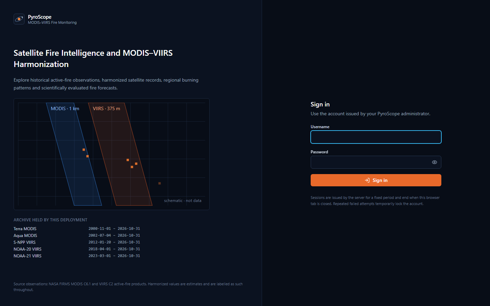 |
| Production admin menu | 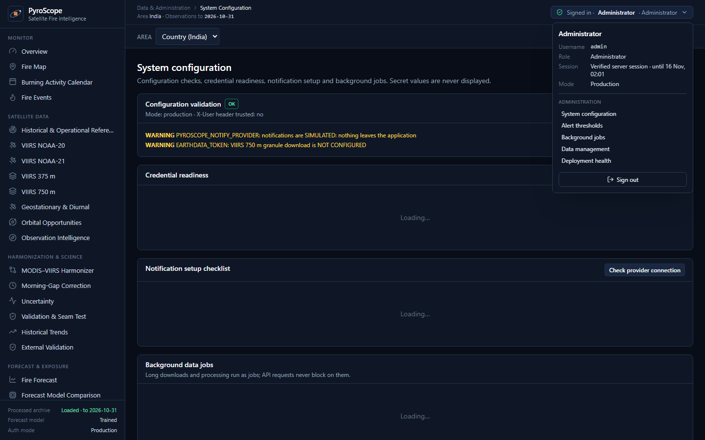 |
| Production analyst overview | 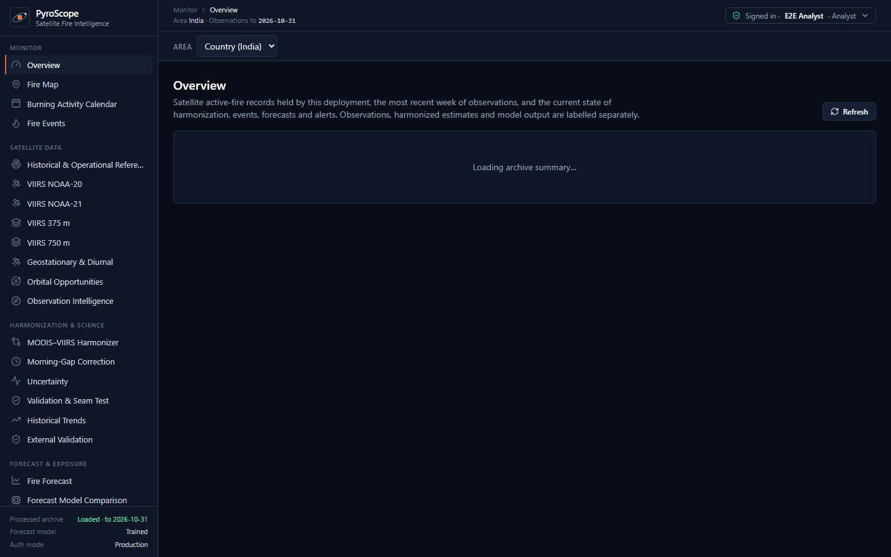 |
| Session expired | 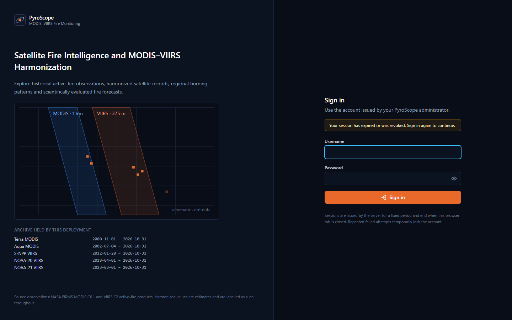 |
| Dev header (demo mode) | 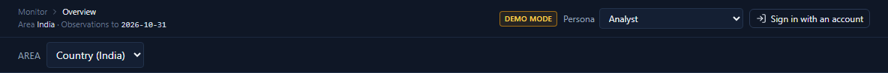 |
| Dev persona switched | 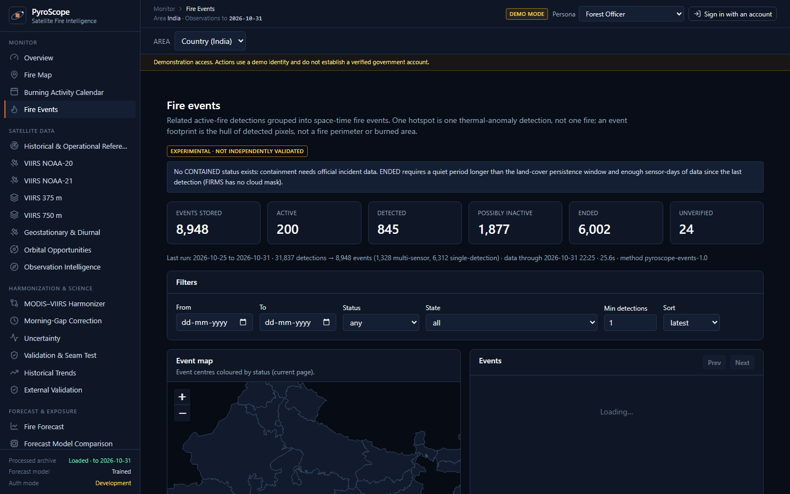 |
| Overview | 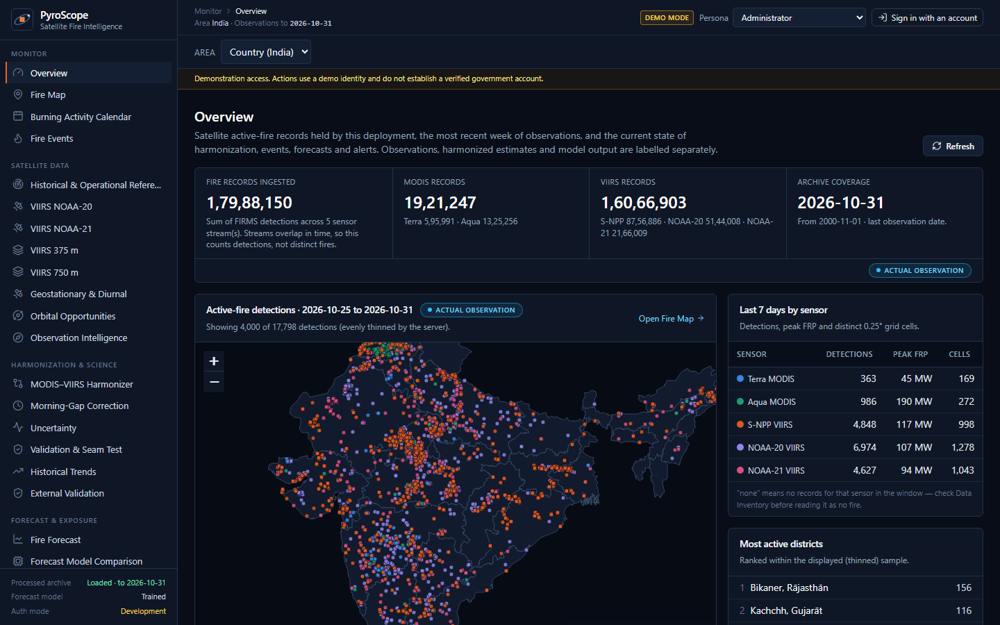 |
| Fire Map | 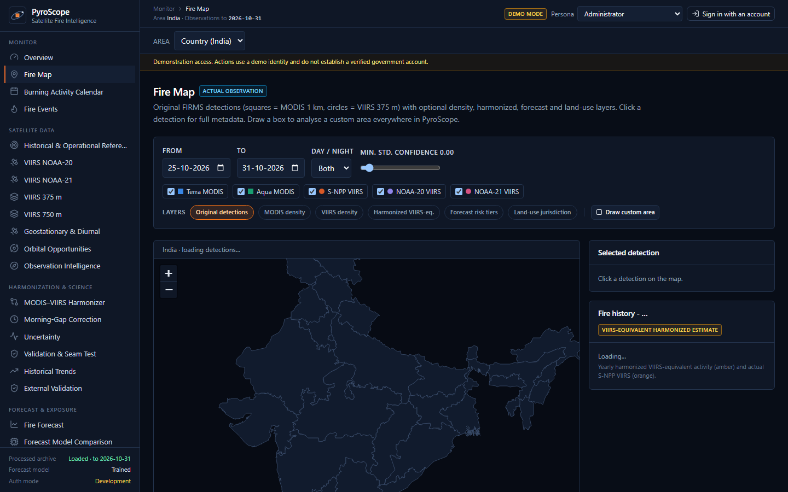 |
| Validation | 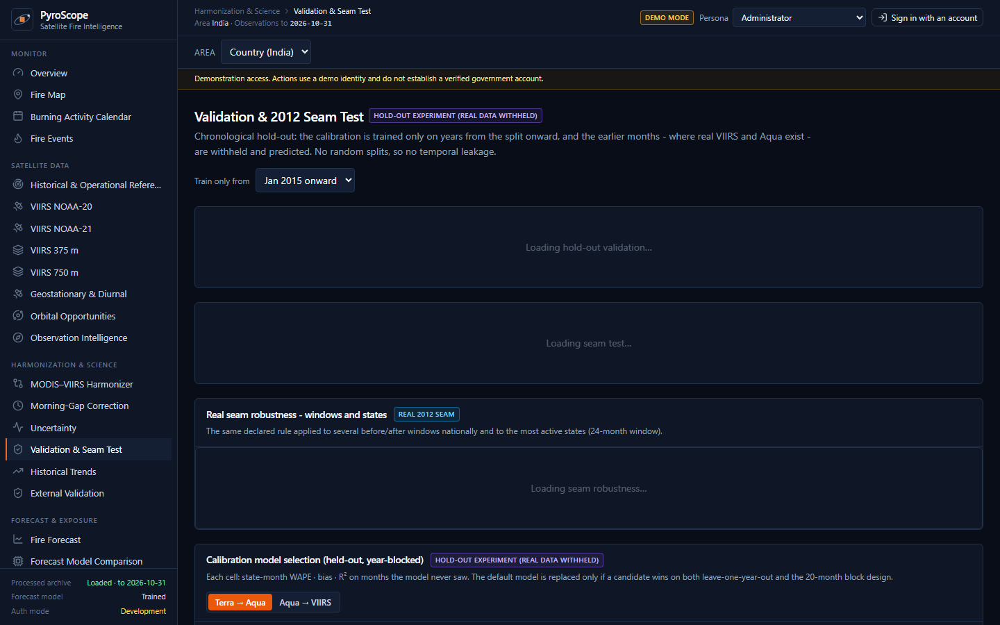 |
| Fire events | 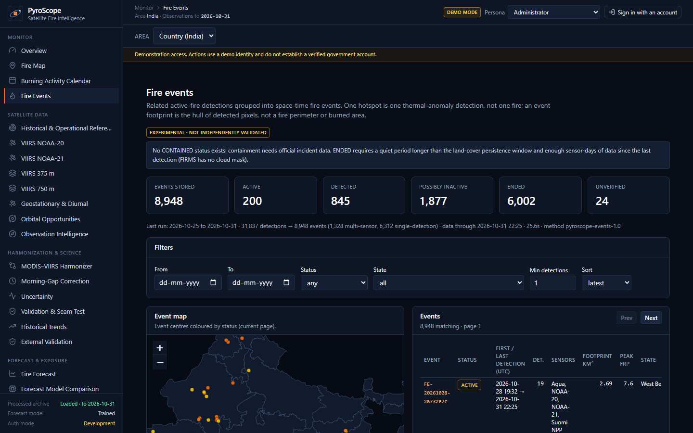 |
| Forecast | 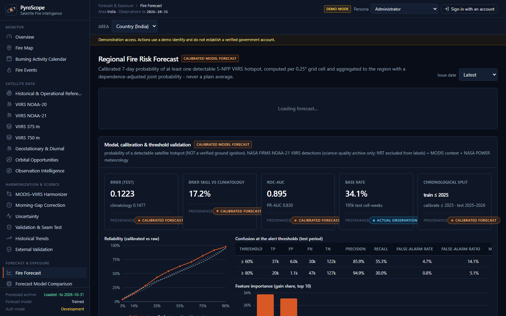 |
| Harmonizer | 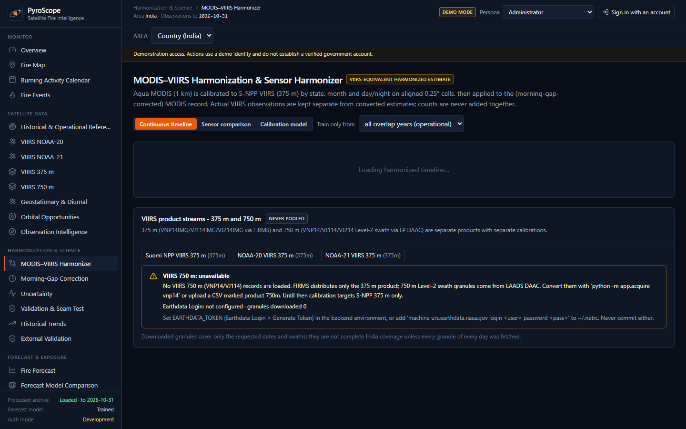 |
| Mobile overview / nav / sign-in | 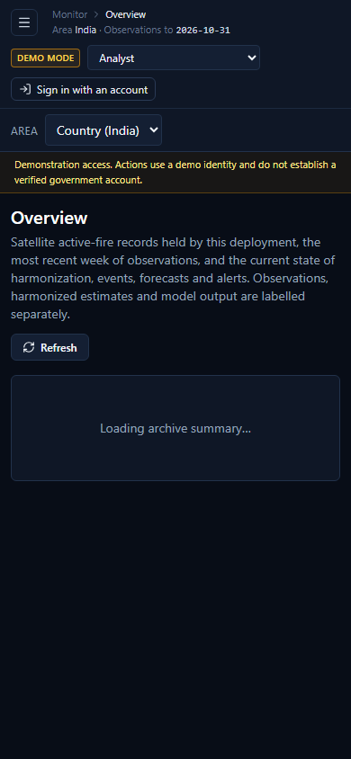 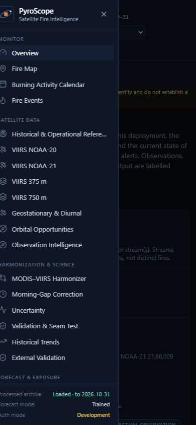 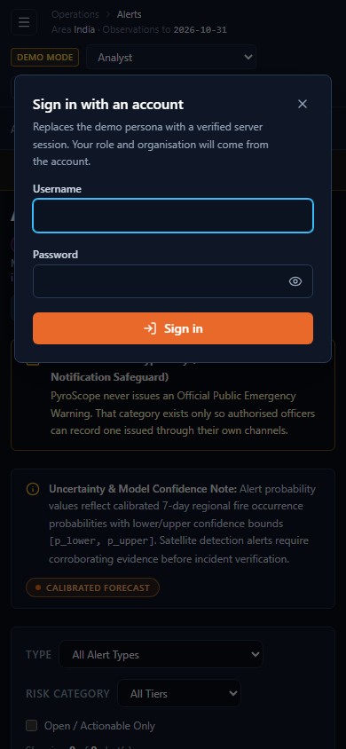 |

## 14. Git commits (branch `feature/pyroscope-auth-ui-final`, pushed to origin)

| Commit | Scope |
|---|---|
| `8036d9e` | Backend: `organisation_name`, real-admin label, session lifecycle tests |
| `11f133e` | Frontend: auth state machine, sign-in/identity UI, shell, overview, design system, basemap |
| `c79630f` | E2E: dev + production stacks, auth journeys, page tour, mobile, credential-free DB copies, CI artifacts |
| `658e1cd` | Docs: this report and screenshots |

`data/pyroscope.db` and `data/reports/*` were intentionally not committed.

## 15. Pull request

The GitHub CLI is not installed in the build environment, so the PR could not be opened automatically. Open it from:
https://github.com/HIFIGUY1234/Pyra/compare/main...feature/pyroscope-auth-ui-final
